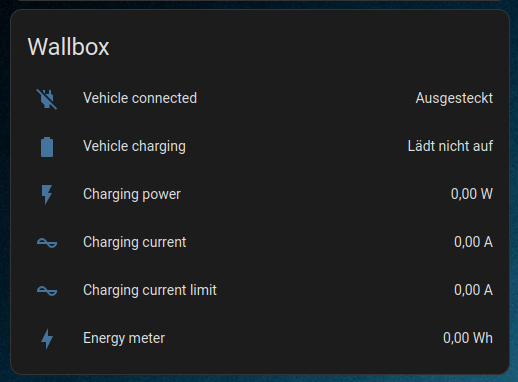

# Setting up Home Assistant

HeidelBridge offers a simple [MQTT API](APIReference.md). It also supports Home Assistant's MQTT auto discovery feature.
This way HeidelBridge can easily be added to Home Assistant:

- Make sure the MQTT integration in Home Assistant is enabled.
- Power on your HeidelBridge.
- The HeidelBridge should immediately show up as an MQTT device.

GUI Example (German):



## PV Surplus Charging Automation

HeidelBridge itself only exposes one control for charging: the current limit
(`number.<device>_control_charging_current_limit`). It accepts `0` A (charging
blocked) or `6.0`-`16.0` A (charging permitted). Deciding *how much* surplus
solar power is available and *which* charging strategy to use is not something
HeidelBridge does - that logic lives entirely in Home Assistant, as an
automation.

To get you started, a ready-made example automation is provided:
[`examples/ha-automation.yaml`](examples/ha-automation.yaml). It offers 5
selectable modes and requires no programming knowledge to set up - just follow
the steps below.

| Mode       | Effect                                                                            |
| ---------- | ---------------------------------------------------------------------------------- |
| Aus        | Charging is blocked (current limit set to 0 A).                                    |
| Manuell    | The automation does nothing; you control the current limit yourself (e.g. via a dashboard card). |
| Max        | Always charges at the maximum current (16 A, or `max_current`, see step 5).        |
| Nur PV     | Charges only from solar surplus; stops as soon as the available surplus drops below 6 A. |
| Min + PV   | Always charges with at least the minimum current (6 A), topped up with any available surplus. |

### 1. Prerequisites

- HeidelBridge is already visible in Home Assistant via MQTT discovery (see
  above).
- You have a sensor entity that reports your current **grid power in Watt**,
  using the sign convention: **positive = drawing power from the grid,
  negative = feeding surplus power into the grid**. This is how most smart
  meter/energy integrations report it (e.g. Tibber, SolarEdge, Shelly EM,
  smart meter integrations via a P1 reader, ...). If you are unsure, open
  *Developer tools > States*, search for your sensor, and watch its value
  while your solar system is producing more than the house consumes - it
  should go negative.

### 2. Create the mode selector helper

The automation is controlled through a dropdown helper.

1. Go to *Settings > Devices & Services > Helpers*.
2. Click *+ Create Helper* and choose *Dropdown*.
3. Set the name to exactly **Wallbox Modus** (this makes Home Assistant
   generate the entity ID `input_select.wallbox_modus`, which the example
   automation expects).
4. Add exactly these 5 options, spelled exactly like this (case and spaces
   matter):
   - `Aus`
   - `Manuell`
   - `Max`
   - `Nur PV`
   - `Min + PV`
5. Click *Create*.
6. Optional but recommended: add the new helper to one of your dashboards
   (e.g. as an *Entities* or *Dropdown* card) so you can switch modes easily.

### 3. Find your entity IDs

Before importing the automation, look up the exact entity IDs you'll need in
*Developer tools > States* (filter by your HeidelBridge device name, default
`heidelbridge`):

- `number.heidelbridge_control_charging_current_limit` - the charging current
  limit (created automatically by HeidelBridge).
- `sensor.heidelbridge_charging_power` - the wallbox's own charging power
  (created automatically by HeidelBridge).
- Your own grid power sensor from step 1.

If you changed the device name in the HeidelBridge web UI, the first two
entity IDs will use that name instead of `heidelbridge`.

### 4. Import the automation

1. Open [`examples/ha-automation.yaml`](examples/ha-automation.yaml) and copy
   its entire content.
2. In Home Assistant, go to *Settings > Automations & Scenes > Automations*.
3. Click *+ Create Automation*, then choose *Start with an empty automation*.
4. Click the three-dot menu in the top-right corner and select
   *Edit in YAML*.
5. Delete the placeholder content and paste the copied YAML instead.
6. Click *Save* (top-right).

### 5. Adjust the automation to match your setup

Still in the YAML editor, replace the two placeholder entity IDs with the
ones you found in step 3:

- Every occurrence of `sensor.smart_meter_ts_65a_3_real_power` → your own grid
  power sensor.
- If your device name isn't `heidelbridge`, every occurrence of
  `number.heidelbridge_control_charging_current_limit` and
  `sensor.heidelbridge_charging_power` → the entity IDs with your device name.

Then check the two variables at the top of the automation. The defaults fit a
three-phase installation that allows 16 A:

- `watts_per_amp` converts surplus power into charging current. It is 230 V
  times the number of phases the car charges on: `690` for three-phase, `230`
  for a single-phase installation. Many cars charge on one phase only even on
  a three-phase wallbox; use `230` for those too. With the wrong value the
  automation computes a third (or three times) of the current the surplus
  actually allows.
- `max_current` is the highest current your installation allows (the
  wallbox's own hardware setting, fuse, cable). The automation never requests
  more than this, in *Max* mode or from surplus.

Save again once done.

### 6. Enable it

- Make sure the automation's toggle (top of the automation list, or the
  editor's header) is switched on.
- Set the `Wallbox Modus` helper to one of the 5 modes described in the table
  above to activate the corresponding charging strategy. Start with `Aus` or
  `Manuell` to verify everything reports correctly before trying `Nur PV` or
  `Min + PV`.

### 7. Troubleshooting

- The automation re-evaluates every minute, and immediately whenever the mode
  changes.
- If nothing seems to happen, open the automation, go to its *Traces* tab,
  and check which condition stopped execution.
- If your grid power or wallbox power sensor briefly shows "unavailable" or
  "unknown" (e.g. during a WiFi/MQTT reconnect), the automation intentionally
  skips that cycle instead of guessing with a wrong value - this is expected
  and resolves itself on the next run a minute later.
- See the [MQTT API reference](APIReference.md) for all available
  HeidelBridge topics and entities if you want to build your own automation
  instead.

## PV Surplus with a Home Battery and Hysteresis

The example automation works well for a plain PV system. Two things need
extra care:

- **A home battery** makes the surplus calculation measure itself (see below).
- **Passing clouds** make *Nur PV* start and stop the car every few minutes,
  because it stops as soon as the surplus drops below 6 A.

Both are solved with two template entities that you add to your
`configuration.yaml`, plus a few changed lines in the automation. The
hysteresis helps without a home battery too: then leave out the lines marked
`{# battery #}`.

### Why a home battery breaks the surplus calculation

The example automation computes the surplus as *grid feed-in plus the car's
own charging power*. Adding the car's power back is necessary: otherwise the
car would consume the very surplus that made it start, and stop again.

With a home battery this turns into a self-sustaining loop. Whenever PV
production falls short, the battery discharges just enough to hold the grid
meter at about 0 W. Grid feed-in is then 0, and the formula reports the car's
own charging power as surplus. The car keeps charging and empties the home
battery. Observed on a real system: the car drew 1399 W, the battery
discharged 1777 W, the grid meter read -13 W, and the formula claimed 1412 W
of surplus.

The fix has three parts:

1. **Subtract battery discharge** from the surplus. Power coming out of the
   battery is never PV surplus.
2. **Gate on the battery's state of charge.** Charging starts only when the
   battery is at least 80 % full and may continue until it drops below 65 %.
   The band is deliberately wide: a charging car quickly pulls the battery
   back under 80 %, so a single threshold would flap.
3. **Credit battery charging above 80 %.** Many inverters charge the battery
   at full power until it is almost full. Between 80 % and 100 % all PV
   power goes into the battery, the grid meter sits at about 0 W, and the car
   would only start once the battery is completely full. Counting the
   battery's charging power as surplus above 80 % lets the car take that
   power instead. Below 80 % the battery has priority.

### Hysteresis

The release signal for *Nur PV* gets separate thresholds and delays for
starting and stopping:

- **Thresholds:** start when the surplus reaches 1500 W, stop when it falls
  below 1250 W. These values are for single-phase charging, where 6 A needs
  1380 W. Between the two, the
  car keeps charging at the 6 A minimum and takes the small difference from
  the grid or the battery.
- **Delays:** start after the surplus has been high enough for 30 seconds,
  stop only after it has been too low for 3 minutes. That rides through
  passing clouds. Most regulation still happens by modulating the current
  between 6 A and `max_current`; the car stops only when the surplus stays
  below the minimum.

For a three-phase installation, 6 A needs 4140 W; use about 4500 W to start
and 3750 W to stop.

### 1. Add the template entities

Add this to your `configuration.yaml` (or merge it into an existing
`template:` section) and replace the sensor IDs with your own:

- `sensor.smart_meter_ts_65a_3_real_power`: your grid power sensor, as in the
  automation (positive = drawing from the grid).
- `sensor.my_battery_power`: your battery power in Watt, **positive =
  discharging, negative = charging**. Some integrations use the opposite
  sign; in that case put a minus in front of it in the `bat` line:
  ``.
- `sensor.my_battery_soc`: your battery's state of charge in %.

```yaml
template:
  - sensor:
      - name: "Wallbox PV Surplus"
        unique_id: wallbox_pv_surplus
        unit_of_measurement: "W"
        device_class: power
        state_class: measurement
        availability: >
          
            {# battery #}
              {# battery #}
          {{ ok }}
        state: >
          
          
          
          
            {# battery #}
              {# battery #}
                                    {# battery #}
                  {# battery #}
          {{ (ev - grid - discharge + credit) | round(0) }}

  - binary_sensor:
      - name: "Wallbox PV Release"
        unique_id: wallbox_pv_release
        delay_on: "00:00:30"
        delay_off: "00:03:00"
        availability: "{{ has_value('sensor.wallbox_pv_surplus') }}"
        state: >
            {# three-phase: about 4500 #}
             {# three-phase: about 3750 #}
          
          
          
            {# battery #}
                      {# battery #}
          {{ surplus >= (stop_w if on else start_w) and battery_ok }}
```

Without a home battery, delete every line marked `{# battery #}`.

Restart Home Assistant (or reload *Template entities* in *Developer tools >
YAML*). Check in *Developer tools > States* that `sensor.wallbox_pv_surplus`
shows a plausible value and that `binary_sensor.wallbox_pv_release` exists.

### 2. Use them in the automation

In the example automation, change three places:

1. Add the release sensor as a trigger, so the car starts and stops as soon
   as the release changes instead of up to a minute later:

   ```yaml
   triggers:
     # ... the two existing triggers ...
     - id: freigabe
       trigger: state
       entity_id: binary_sensor.wallbox_pv_release
   ```

2. In the `variables` of the *Nur PV / Min + PV* branch, take the surplus from
   the new sensor:

   ```yaml
   available_power: "{{ states('sensor.wallbox_pv_surplus') | float(0) }}"
   ```

   and extend the availability check above it with
   `and states('sensor.wallbox_pv_surplus') not in ['unavailable', 'unknown']`.

3. In the *Nur PV* branch, let the release sensor decide whether to charge,
   and charge at least 6 A while it is on:

   ```yaml
   new_limit: >-
     {{ ([max_amps, 6] | max)
        if is_state('binary_sensor.wallbox_pv_release', 'on') else 0 }}
   ```

*Min + PV* keeps charging at 6 A whatever the surplus, so with a battery the
car still takes those 6 A from it when there is no PV; that is what the mode
is for. The corrected surplus only stops the top-up above 6 A from coming out
of the battery.
